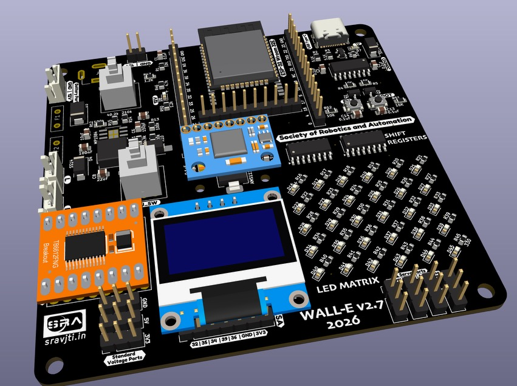
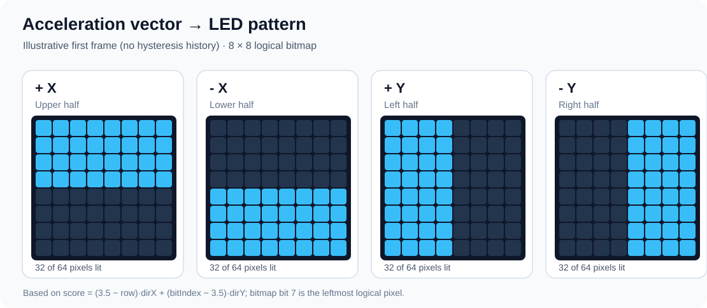
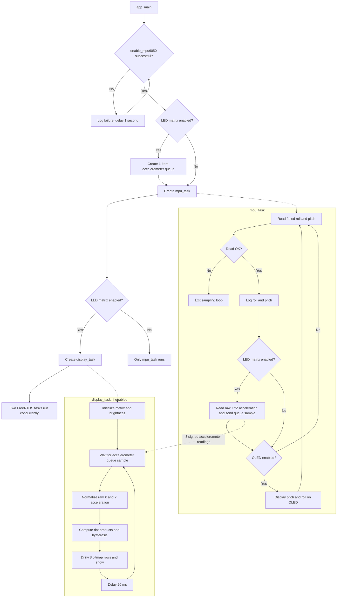

# MPU6050: Orientation Sensing and LED Matrix Visualisation

This example reads an **MPU6050 six-axis IMU** on the SRA board and illustrates two ways to use its measurements:

- **Orientation feedback:** estimate roll and pitch using the board component's complementary filter, print them to the serial monitor, and optionally show them on the OLED.
- **Accelerometer visualisation:** use raw X/Y acceleration to produce a changing pattern on the **8×8 MAX7219 LED matrix**.

The source of this example is [`main/main.c`](main/main.c). It uses the common [SRA board component](../components/sra-board-component) for MPU6050, OLED and LED matrix drivers.

## Contents

- [Hardware and configuration](#hardware-and-configuration)
- [How the MPU6050 works](#how-the-mpu6050-works)
- [How this example works](#how-this-example-works)
- [Accelerometer-to-LED mapping](#accelerometer-to-led-mapping)
- [Functions used](#functions-used)
- [Code flowchart](#code-flowchart)
- [Build and run](#build-and-run)
- [Notes and limitations](#notes-and-limitations)

## Hardware and configuration

The MPU6050 measures acceleration on X, Y and Z and angular velocity about those axes. The ESP32 communicates with it over **I²C**, using the SRA board's wiring. In the checked-in board component the MPU6050 uses address `0x68`, `SCL = GPIO21`, `SDA = GPIO14`, and an I²C clock of 100 kHz. The driver configures the accelerometer range to **±2 g** and the gyroscope range to **±250°/s**.

The default target for this project is `esp32s3` (`sdkconfig.defaults`). The board component provides these Kconfig switches:

| Setting | Effect |
| --- | --- |
| `CONFIG_ENABLE_LED_MATRIX` | Builds the accelerometer-driven matrix display task. Enabled by default in the board component. |
| `CONFIG_ENABLE_OLED` | Adds OLED initialisation and displays roll/pitch. Enabled by this example's `sdkconfig.defaults`. |

An 8×8 LED matrix connected through a **MAX7219** is used for the live pattern. Its display driver converts logical bitmap rows into the board-specific hardware register layout; the application does not send MAX7219 registers itself.



## How the MPU6050 works

### Reading accelerometer and gyroscope data

The accelerometer reports *specific force*, including gravity. With the configured ±2 g range, approximately **16384 raw counts correspond to 1 g**. The three accelerometer axes occupy six consecutive bytes starting at register `0x3B`; each signed 16-bit sample is assembled from a most-significant and a least-significant byte. The gyroscope samples are likewise read from six bytes starting at register `0x43`.

To read a register over I²C, the controller typically writes the register address, issues a repeated START, then reads the requested bytes. For a write, the address byte uses the *write* direction (`R/W = 0`); for a read, it uses the *read* direction (`R/W = 1`).

### Roll and pitch estimation

The accelerometer gives an inclination estimate from gravity, but is sensitive to linear movement. Integrating gyroscope angular velocity gives smooth short-term changes, but introduces drift. The board driver combines both estimates using a complementary filter:

```text
fused_angle = alpha * (previous_fused_angle + gyro_delta)
            + (1 - alpha) * (accelerometer_angle - offset)
```

For the pinned board component, `alpha = 0.995`. The resulting `euler_angle[0]` is **roll** and `euler_angle[1]` is **pitch**. These angles feed the serial log and optional OLED, **not** the LED matrix calculation.

## How this example works

The application initialises the MPU6050 in `app_main()`, retrying every second until initialisation succeeds. It then starts the measurement task. If the LED matrix option is enabled, it also creates a one-item FreeRTOS queue and starts a display task.

**`mpu_task` — sensor readings**

1. Call `read_mpu6050(euler_angle, mpu_offset)` to obtain fused roll and pitch.
2. Print both angles to the serial monitor.
3. With the LED matrix enabled, read six raw accelerometer bytes, combine them into three signed `int16_t` values, and send the array to `accel_queue`.
4. With the OLED enabled, call `display_mpu(pitch, roll)`.
5. Repeat as long as the fused sensor-read function returns `ESP_OK`.

**`display_task` — visual output**

1. Initialise the MAX7219 matrix and set brightness to `4` (on a scale of 0–15).
2. Wait for a raw accelerometer sample from `accel_queue`.
3. Use X and Y acceleration to calculate a normalised 2D direction.
4. Calculate whether each of the 64 LEDs should be on using a dot product and hysteresis.
5. Copy the eight bitmap bytes into the matrix framebuffer with `led_matrix_draw_bitmap()`, then update the display with `led_matrix_show()`.
6. Pause 20 ms and process the next queued sample.

The queue holds **one complete three-axis sample**, not three separate messages. Its length is one, so the producer may block when the display task has not yet consumed the previous sample.

## Accelerometer-to-LED mapping

The display uses the following calculations from `display_task()`:

```c
// Raw sensor values use ±2 g accelerometer scaling.
dir_x = (float)acce_raw_value[0] / 16384.0f;
dir_y = (float)acce_raw_value[1] / 16384.0f;

normalizing_factor = sqrtf(dir_x * dir_x + dir_y * dir_y);
normalized_dir_x = dir_x / normalizing_factor;
normalized_dir_y = dir_y / normalizing_factor;

// For each matrix row i and column-bit index j:
float pos_x = 3.5f - i;
float pos_y = j - 3.5f;
float score = pos_x * normalized_dir_x + pos_y * normalized_dir_y;
```

The dot product is positive on the side of the display pointed to by the acceleration vector. An LED that was **off** turns on when `score > 0.30`; an LED that was **on** stays on until `score <= -0.30`. This hysteresis reduces flickering near the dividing boundary.

The application sets bits with `rows[i] |= 1 << j`. In the logical bitmap, **bit 7 is the leftmost LED** and bit 0 is the rightmost. Therefore a positive Y raw reading fills the **left** half of the logical display, while positive X fills the **upper** half. The low-level driver transposes the logical rows to match the board's actual MAX7219 wiring.



*Illustration generated from the pixel thresholding logic, starting with all LEDs off; **not a recording of a physical board**. The actual display can retain some previously lit pixels near boundaries because of hysteresis.*

### Bitmap example

The top four logical rows on, with the bottom four off, can be represented as eight hexadecimal bytes:

```c
uint8_t bitmap[8] = {
    0xFF, 0xFF, 0xFF, 0xFF,
    0x00, 0x00, 0x00, 0x00
};

ESP_ERROR_CHECK(led_matrix_draw_bitmap(&matrix, bitmap));
ESP_ERROR_CHECK(led_matrix_show(&matrix));
```

Every hexadecimal digit represents four adjacent LED bits. `0xFF` (`11111111` in binary) lights every LED in a logical row, while `0x00` (`00000000`) turns that row off.

## Functions used

| Function | Role in this example |
| --- | --- |
| `enable_mpu6050()` | Set up I²C and the MPU6050 sensor; select measurement ranges and wake the device. |
| `read_mpu6050(euler_angle, mpu_offset)` | Read acceleration and gyro data, run the complementary filter, return roll and pitch. |
| `mpu6050_read_acce(acce_bytes, BUFF_SIZE)` | Read six raw accelerometer bytes (X, Y, Z). |
| `combine_msb_lsb_raw_data(acce_bytes, acce_raw_value)` | Combine those six bytes into three signed 16-bit samples. |
| `xQueueCreate(1, sizeof(int16_t) * (BUFF_SIZE / 2))` | Make a single-element FreeRTOS queue that stores one three-axis sample. |
| `xQueueSend(...)` / `xQueueReceive(...)` | Transfer raw accelerometer samples between the measurement and display tasks. |
| `led_matrix_init(&matrix)` | Initialise the MAX7219 display and framebuffer. |
| `led_matrix_set_brightness(&matrix, 4)` | Set display brightness to level 4. |
| `led_matrix_draw_bitmap(&matrix, rows)` | Copy the generated eight-byte image into the logical framebuffer. |
| `led_matrix_show(&matrix)` | Transpose as needed for board wiring and send the framebuffer to the LEDs. |
| `init_oled()` / `display_mpu(pitch, roll)` | Initialise and update the OLED, when enabled. |

`mpu_task()` and `display_task()` are defined in [`main/main.c`](main/main.c). The lower-level `mpu6050_*` and `led_matrix_*` APIs live in [`sra-board-component`](../components/sra-board-component).

## Code flowchart

This chart reflects the actual task creation, queue, and optional display branches in the current example. GitHub renders the Mermaid diagram directly.



## Build and run

With the SRA ESP-IDF toolchain activated, run these commands from `3_MPU/`:

```bash
idf.py menuconfig             # Optional: configure OLED / LED matrix
idf.py build
idf.py -p <PORT> flash monitor
```

Choose the serial port connected to the board (for example `/dev/ttyUSB0` on many Linux systems). The default build target is **ESP32-S3**; check your board hardware and existing configuration before changing it. In the monitor, look for `Roll: ... | Pitch: ...` readings. Tilting the board should change the LED pattern when the LED matrix is enabled.

## Notes and limitations

- This example is a **visualisation**, not a calibrated acceleration or orientation instrument. The LED task uses raw X/Y acceleration independently of the complementary-filter angles.
- The current implementation does not handle zero X/Y magnitude before normalising. When both values are zero, the division can produce non-finite values; handling this would require a separate firmware change.
- `mpu_task()` exits its sampling loop when `read_mpu6050()` returns an error, whereas `display_task()` keeps waiting for queued data. There is no automatic recovery inside the measurement task.
- The source code has no explicit sampling delay in `mpu_task()`. The 20 ms delay applies only to `display_task()`.

For the MAX7219 hardware register details and bitmap orientation, also see the [SRA board LED matrix API](../components/sra-board-component/include/led_matrix.h).
